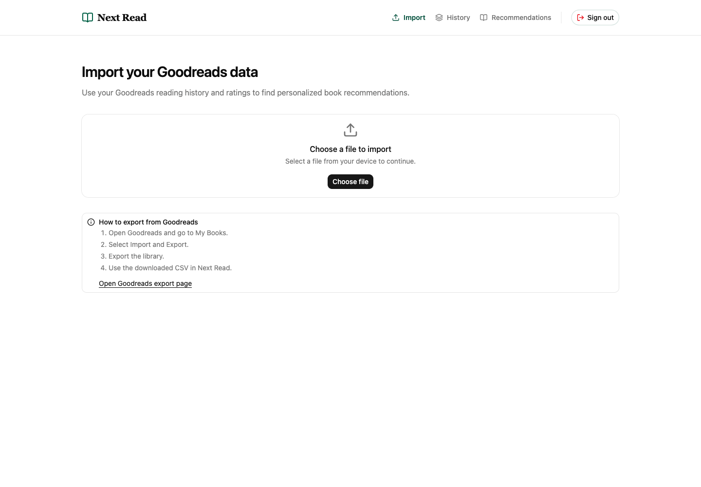
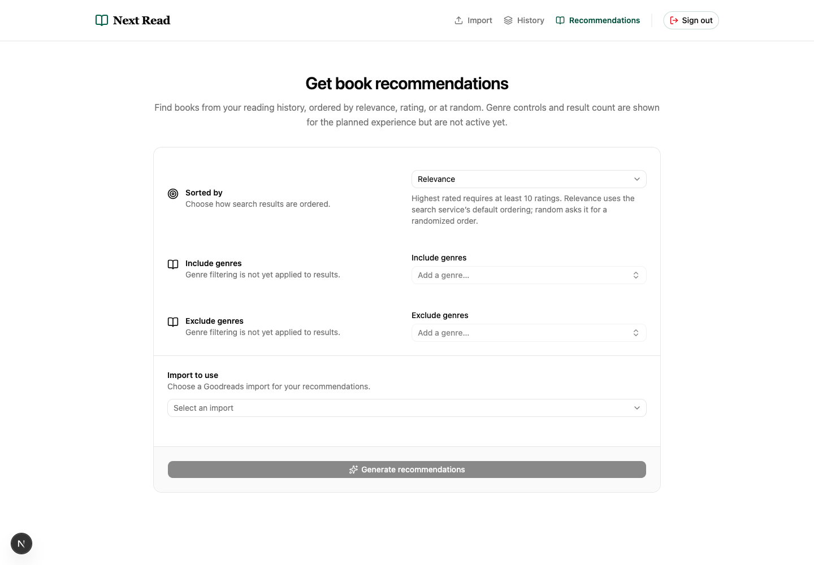
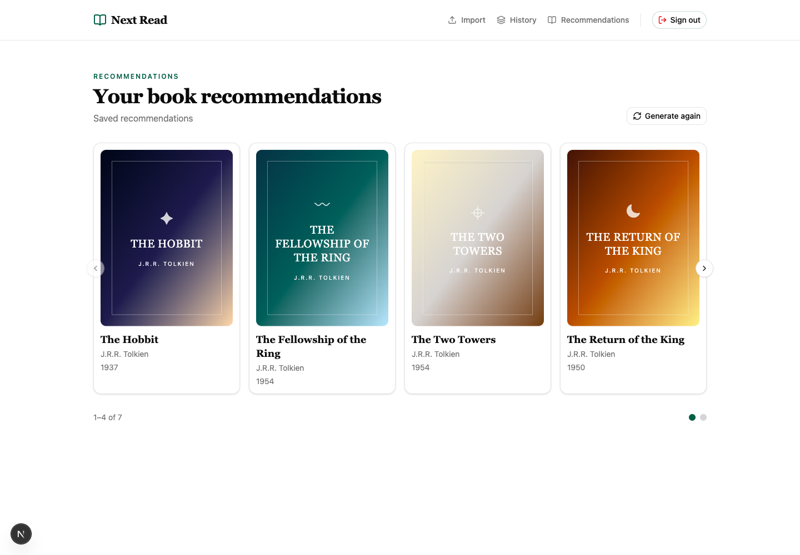

# Next Read

A book discovery demo built with Next.js App Router, Supabase email/password auth, TypeScript,
Tailwind CSS, local shadcn/ui components (the CLI's standard Base Nova defaults),
and Lucide icons. Discovery uses OpenLibrary API for all recommendations. Project built as a practice
for figuring out agentic workflows and tooling.

## Screenshots

### Import



### Recommendations



### Recommendation results



## Run locally

Requires Node.js 22.12+ and npm.

```sh
npm ci
npm run dev
```

Create a Supabase project and copy `.env.example` to `.env.local`, then set
`NEXT_PUBLIC_SUPABASE_URL` and `NEXT_PUBLIC_SUPABASE_ANON_KEY` from the project's
API settings. Never use or expose a service-role key in this app. In Supabase
Authentication URL Configuration, set the local site URL to
`http://localhost:3000` and add `http://localhost:3000/auth/callback` as a
redirect URL. Add the equivalent production callback URL when deploying. Email
confirmation can be enabled; users will need to confirm through the callback
before they can sign in. Set the same two public environment variables in Vercel.

Visit `http://localhost:3000`; `/` is public and app routes require sign-in.

The import screen posts the selected CSV to the server, where it is parsed and the
import and its book rows are persisted in Supabase. Recommendations require an
explicitly selected import belonging to the authenticated user. The recommendation
experiment records exact Open Library subject strings and observation counts in the subject table;
it does not alter the curated subject list.

`/app/admin/subjects` is a direct URL, read-only subject listing for users with
trusted `app_metadata.is_admin: true`. Apply migrations in timestamp order,
including `20261102000000_fix_record_subject_candidates_collation.sql`, before
using it. This forward correction fixes SQLSTATE 42803 in the subject RPC while
preserving its validation, restricted grants, and behavior. Set the flag through
Supabase Auth Admin/API (never `user_metadata`);
JWT refresh/expiry can delay revocation. Enabled status is read-only.
The listing is URL-paginated in pages of 20 and can be sorted by Subject or
Occurrences; query ordering is preserved when navigating between pages.

## Recommendations engine

The engine uses Goodreads ratings and Open Library subjects, not AI. Reviews,
global subject popularity does not influence results. Optional transient genre
filters constrain Open Library subject keys independently of personalized subjects:
include matches any selected genre and exclude rejects any selected genre.

1. **Sample books.** Authenticated `POST /api/recommendations` loads only the
   selected import. It accepts numeric ratings from 0–5, randomizes ties, and
   takes the top 30 before validating identifiers. ISBNs are normalized,
   checksum-validated, converted to ISBN-13, and deduplicated; up to ten eligible
   books are then sampled randomly without replacement.
2. **Fetch subjects.** One GET to `https://openlibrary.org/api/books` combines
   sampled ISBNs into comma-separated, ISBN-prefixed `bibkeys`, with `format=json`
   and `jscmd=data`. Parameters are URL-encoded using `URL.searchParams`. Only
   requested books are read; nonblank subjects are preserved exactly and counted
   once per book. Observation counts are persisted without changing enabled status.
3. **Build the search.** The three most frequent subjects from this request are
   selected, with random ties; stored counts and enabled flags are ignored.
   Query keys are lowercased, stripped of Open Library's excluded punctuation,
   converted from spaces to underscores, deduplicated, and escaped. One GET to
   `https://openlibrary.org/search.json` joins exact `subject_key` clauses in a
   parenthesized OR group, then adds `AND language:eng` to require an English
   edition. Optional inclusive publication-year and page-length ranges are
   explicit fielded clauses in the decoded `q` expression (including a
   parenthesized, field-qualified OR for selected length bands), not standalone
   parameters. Genre include/exclude predicates are ANDed outside the personalized
   subject OR. The fixed 15 keys were checked against Open Library subjects on
   2026-11-08; provider availability can change. Requests fetch 50 works per batch and only title, author, year,
   median page count, ISBN, cover, and work-key fields. Relevance omits sorting; Highest rated adds
   `sort=rating` and a minimum of ten ratings; Random adds `sort=random`.
4. **Filter and save.** Filter and deduplicate results, backfilling up to three batches/150 candidates (one for Random),
   and exclude ISBN matches against the entire selected import. There is no
   unrelated fallback. Save the ordered results atomically, including
   successful empty sets, then open the saved results page.

The pipeline shares a 40-second deadline; search gets at most 30 seconds within
that budget. Both provider responses are capped at 2 MiB, and search URLs at
8,192 characters. There are no retries. Books API failures can yield empty results;
search, import-read, or persistence failures show an unavailable state instead.

Implementation: [`recommendations-engine.ts`](src/lib/recommendations-engine.ts),
[`open-library/`](src/lib/open-library/), and the
[`recommendations endpoint`](src/app/api/recommendations/route.ts).

## Verification

```sh
npm run lint
npm run format:check
npm run typecheck
npm test
npm run build
```

`npm run format` formats application and configuration files, leaving the original
plan, design, and `.opencode` tooling untouched. Tests use Vitest and Testing
Library. Run `npm start` after a production build to preview production output.

For direct browser testing with OpenCode, ask: `Use @ui-testing to check the
recommendations page`. The project skill in
`.opencode/skills/ui-testing/SKILL.md` covers Playwright login with the ignored
root `.sampleuser` file (`TEST_USERNAME` and `TEST_PASSWORD`), responsive and
keyboard checks, and safe credential handling. It requires local Supabase
configuration and the Playwright browser tools; it does not add an E2E runner.
The root `opencode.json` overrides the Playwright MCP with
`@playwright/mcp@latest --secrets .sampleuser --isolated`, running from the
repository workspace. Create the ignored root `.sampleuser` file privately before
connecting. The skill passes only secret key names to Playwright's form-fill
tools; the MCP server resolves their values. No absolute paths or credentials
are stored in the override. Redaction does not protect screenshots or traces;
avoid recording during login. OpenCode reloads config automatically; use `/reload`
if needed and `/mcps` to check the connection.

Route files compose local components without page-level styling. UI primitives
and responsive application presentation live under `src/components`.
